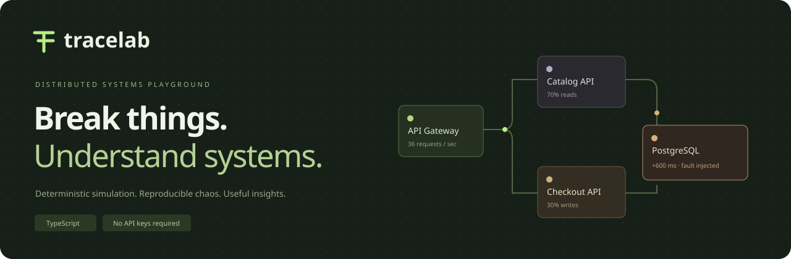

<p align="center"></p>

<p align="center"><strong>An interactive distributed-systems resilience playground.</strong><br />Inject faults. Follow requests. Compare strategies. Replay the exact experiment.</p>

<p align="center">TypeScript · Discrete-event simulation · Zero runtime dependencies · Node.js tests · GitHub Pages</p>

## What is TraceLab?

TraceLab makes a normally invisible system visible. A commerce stack receives simulated traffic through an API gateway, catalog and checkout services, a cache, and a database. You can slow a dependency, take it offline, or introduce intermittent errors, then observe the consequences for queues, latency, and request completion.

The dashboard is backed by a working simulation engine. Metrics are calculated from simulated requests. It sends **no real service traffic**, needs **no API keys**, and runs entirely in the browser.

### Try it locally

Requires **Node.js 22 or newer** and npm.

```bash
npm ci
npm test
npm start
```

Open **http://localhost:4173**. `npm test` builds the app before running the suite. For a build without tests, use `npm run build`.

## A two-minute demo

1. **Start with Steady state.** Press **Run simulation**. All initial metrics come from a deterministic 12-second warm-up.
2. **Pick PostgreSQL.** Select **Latency spike** in the control room and click **Inject fault**. Try increasing traffic to 120 req/s. The bounded queue grows; requests may hit their deadline.
3. **Open Retry storm.** The database is down for 12 simulated seconds. Watch repeated attempts and failed requests, then open **Request traces** to inspect outcomes.
4. **Open Experiments.** Run a comparison to measure three strategies against the same arrival sequence and database outage.
5. **Save or export the session.** Exported JSON includes the initial seed, ordered interventions, elapsed time, and a summary. Import reconstructs the experiment from its events.

Keyboard shortcuts: **Space** run/pause, **R** reset, **?** help. Shortcuts do not override focused form controls. Playback pauses while the browser tab is hidden.

## Features

| Capability            | Implementation                                                                         |
| --------------------- | -------------------------------------------------------------------------------------- |
| Service topology      | Five inspectable services with worker-pool, queue, fault, and circuit states           |
| Traffic controls      | 1–180 incoming requests/s, single-second stepping, 1×/2×/4× playback                   |
| Fault injection       | +600 ms service latency, 65% intermittent errors, or a 100% error outage               |
| Retries               | 0–3 retries per service, exponential backoff with deterministic jitter                 |
| Circuit breaker       | Closed / open / half-open; five consecutive failures; three-second cooldown; one probe |
| Backpressure          | Bounded service queues; overloaded services reject new work                            |
| Deadlines             | An end-to-end deadline prevents requests from waiting indefinitely                     |
| Request explorer      | Latest 120 completions, success/failure filtering, request-ID search, route details    |
| Strategy benchmark    | Same seed, traffic, and outage timing for three policies; drains outstanding requests  |
| Reproducible sessions | Local persistence, portable JSON export/import, validation, deterministic replay       |
| Responsive UI         | Mobile navigation, keyboard-operable controls, reduced-motion support                  |

## Why this is an engineering project

- **An isolated domain engine.** The simulation has no DOM, timers, or framework imports. It can run under Node.js or in the browser.
- **A real scheduling algorithm.** A stable binary min-heap processes events in `O(log E)` time. Equal timestamps use insertion order as a tie-breaker.
- **Reproducible randomness.** Request routes and per-attempt outcomes are generated from the seed and request identity. Retry policies do not shift a shared global random stream.
- **Explicit lifecycle rules.** Requests terminate once. Service work already in progress releases its worker even when its request has timed out. Circuit generation numbers prevent old completions from changing a newer circuit state.
- **Bounded observations.** The application retains 120 traces, 180 chart samples, 60 system events, and 2,000 successful latencies. Service queues and worker pools are also bounded.
- **Meaningful tests.** The suite checks request conservation, queue capacity, single-probe recovery, deterministic replay, failure modes, and DOM interactions.

Read [the architecture](docs/ARCHITECTURE.md) and [the demo guide](docs/DEMO.md) for deeper explanations and interview talking points.

## Understand the numbers

| Metric              | Definition                                                                                     |
| ------------------- | ---------------------------------------------------------------------------------------------- |
| Successful requests | Cumulative successes / cumulative resolved requests; unresolved requests are excluded          |
| Throughput          | Successful completions in the last complete simulated second                                   |
| P95 latency         | Nearest-rank 95th percentile of the last 2,000 successful request durations                    |
| Queued requests     | Live requests waiting for a service worker; excludes active work and retry backoff             |
| Service attempts    | Work actually started by a service, including retries                                          |
| Retries             | Retry attempts scheduled after dependency failure; a deadline or circuit can prevent execution |
| Rejected early      | Requests rejected because a circuit disallows work or a queue is full                          |

**A breaker is not a success-rate guarantee.** It can reduce attempts to an unhealthy dependency while rejecting more requests during cooldown. Compare both dependency work and request outcomes. Successful-only P95 does not describe failed-request latency.

The animated packets illustrate direction; they do not represent one packet per request.

## Run the checks

```bash
npm run typecheck       # Strict TypeScript checks
npm test                # Build + engine, replay, and DOM interaction tests
npm run build           # Static output in dist/
npm run format          # Format source and documentation
```

Tests use Node.js's built-in test runner. DOM tests use LinkeDOM. The app has no runtime npm dependencies. CI repeats type checking, tests, and the build for pushes and pull requests.

**Verification scope:** Automated checks cover simulation logic and DOM interactions. Visual layout has not been verified in a real browser in the creation environment; check desktop and mobile layouts before your public launch.

## Put it on your GitHub

Create an empty repository named `tracelab`, extract the project, and run:

```bash
git init -b main
git add .
git commit -m "Build TraceLab resilience simulator"
git remote add origin https://github.com/YOUR_USERNAME/tracelab.git
git push -u origin main
```

For a live demo:

1. In your repository, open **Settings → Pages** and choose **GitHub Actions** as the source.
2. Open **Actions → Deploy GitHub Pages → Run workflow**.
3. Add the returned demo URL to the repository's **About** section and to the top of this README.

The app uses relative asset URLs and works under a repository subpath. The deployment workflow is manual so tests and code review can happen before publishing.

Suggested repository description:

> Interactive distributed-systems simulator with deterministic replay, fault injection, bounded queues, exponential retries, and circuit breakers. Built with TypeScript.

Suggested topics: `typescript`, `distributed-systems`, `chaos-engineering`, `simulation`, `circuit-breaker`, `data-visualization`, `system-design`.

## Project layout

```text
src/
  engine.ts             Event scheduler, requests, queues, and resilience policies
  session.ts            Portable session validation and deterministic replay
  presets.ts            Four guided experiment configurations
  app.ts                UI, controls, SVG charts, persistence, and interaction
  styles.css            Responsive design and reduced-motion rules
public/
  index.html            Static entry point
  favicon.svg           TraceLab brand mark
scripts/
  build.mjs             Copies static assets after TypeScript compilation
  serve.mjs             Small localhost-only development server
tests/
  engine.test.mjs       Simulation and replay correctness
  app.test.mjs          DOM interaction coverage
docs/
  ARCHITECTURE.md        Model, event lifecycle, and design decisions
  DEMO.md                Demo script and discussion prompts
.github/workflows/
  ci.yml                Type checking, tests, and build
  pages.yml             Manual static deployment
```

## Model assumptions and limits

- This is a single-threaded educational simulator, not production infrastructure or a capacity-planning tool.
- Requests follow sequential routes: 70% catalog reads and 30% checkout writes. Catalog reads have a 72% cache-hit probability.
- Arrivals have bounded jitter around the selected rate, rather than a Poisson arrival process. Service time is uniformly jittered around a configured base latency.
- Fault behavior is determined when service work starts. A fault does not retroactively change already-running work.
- There is no network topology latency, shared CPU, autoscaling, transaction rollback, duplicate-write model, cache eviction, or cross-service retry nesting.
- The circuit breaker is modeled per destination service, shared by callers. It is driven by service completion failures, not end-to-end request timeouts.
- The app supports sessions up to ten simulated minutes with 500 interventions. It keeps up to 12 sessions in local browser storage. Nothing is synchronized between devices.
- Retry budgets, adaptive load shedding, full request-span timing, worker-thread simulation, and browser end-to-end tests are useful future extensions, not implemented features.

## References

The implementation is an original educational model informed by these pattern descriptions:

- [Microsoft Azure Architecture Center: Circuit Breaker pattern](https://learn.microsoft.com/en-us/azure/architecture/patterns/circuit-breaker)
- [Microsoft Azure Architecture Center: Retry pattern](https://learn.microsoft.com/en-us/azure/architecture/patterns/retry)
- [GitHub Docs: Using custom workflows with GitHub Pages](https://docs.github.com/en/pages/getting-started-with-github-pages/using-custom-workflows-with-github-pages)

## License

[MIT](LICENSE). Use it, extend it, and make it yours.
