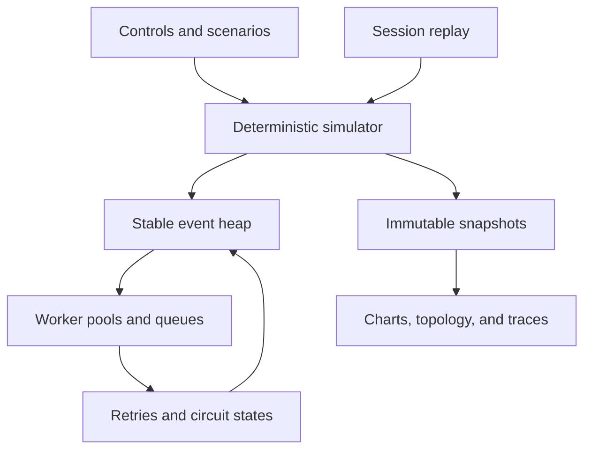
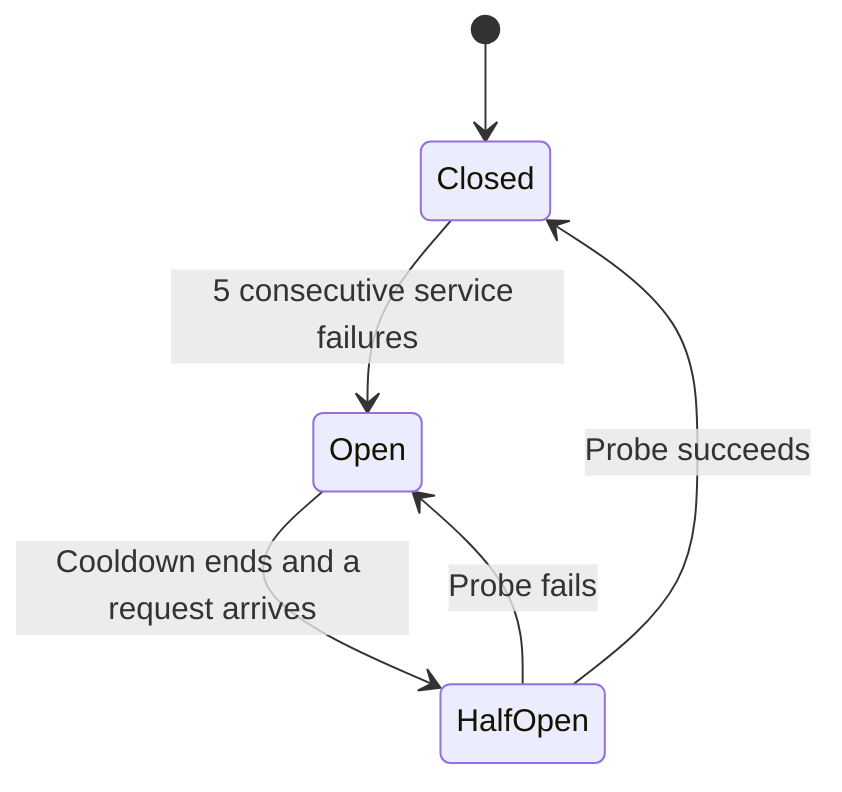

# TraceLab architecture

## The separation that matters

The engine owns simulated reality. The browser owns playback and presentation. Advancing the engine by 12,000 ms once produces the same state as advancing it by 100 ms 120 times. Real animation speed never changes request outcomes.



### Modules

| Module       | Responsibility                                                                                        |
| ------------ | ----------------------------------------------------------------------------------------------------- |
| `engine.ts`  | Config validation, scheduler, request lifecycle, fault model, service policies, snapshots, benchmarks |
| `session.ts` | Validate portable sessions and replay ordered interventions                                           |
| `presets.ts` | Named configurations and guided lessons                                                               |
| `app.ts`     | UI state, event handlers, playback clock, accessible controls, storage, exports                       |

No production service calls, credential handling, or server persistence are required.

## Events and timing

An event has a timestamp and a monotonic insertion sequence. The binary min-heap compares timestamp first, sequence second. This preserves stable ordering for simultaneous events without relying on array-sort behavior.

Event kinds:

- **Arrival:** creates a request, schedules its deadline, dispatches it, then schedules the next arrival.
- **Done:** releases the worker, updates health and circuit state, and either advances the route, schedules a retry, or resolves failure.
- **Retry:** attempts the same route stage after backoff.
- **Timeout:** resolves a still-live request as failed.

Metric samples are taken at exact one-second boundaries, before events at that timestamp. Therefore a completion exactly on a boundary belongs to the next measurement interval. Charts show the last complete interval.

Per-event heap operations cost `O(log E)`, where `E` is pending events. Percentile snapshots sort up to 2,000 successful durations. This bounded approach is intentionally simpler than a streaming quantile estimator.

## A request's life

1. Choose the read or checkout route from its identity and seed.
2. Set an absolute end-to-end deadline.
3. At each service, check circuit admission and worker capacity.
4. Start work, join the bounded queue, or fail early.
5. On service failure, retry with capped exponential backoff if permitted.
6. On success, advance to the next service.
7. On final completion, deadline, or rejection, remove the request from the live map exactly once.

An already-running service event still completes if its request times out. It releases capacity and contributes to service health, but cannot resurrect or double-complete the request. Queued expired request IDs are discarded during admission and draining.

The engine conserves requests:

```text
started = succeeded + failed + inFlight
```

Every worker pool maintains `0 ≤ active ≤ concurrency`; every live queue maintains `0 ≤ queued ≤ queueLimit`.

## Circuit breaker



An open circuit rejects work for 3,000 ms. The first admissible request after cooldown becomes the only half-open probe. Other callers fail fast until that probe finishes. A successful probe closes the circuit; a failed probe opens another cooldown.

Each opening increments a generation number. In-flight completions from an older generation still free their workers, but cannot override the current circuit's health decision. This prevents a delayed completion from accidentally closing a newer open circuit.

The model uses one breaker per destination service. It does not implement per-caller breakers or timeout-driven failure classification. These are deliberate modeling choices.

## Randomness and comparisons

A deterministic 32-bit hash maps a seed and request identity to a value in `[0, 1)`. Routes and interarrival jitter depend on request ID. Service duration, failure, and backoff samples additionally depend on route stage, retry number, and a channel identifier.

This avoids the comparison bias of a single mutable PRNG stream: extra retries in one policy do not change the subsequent arrival sequence or other requests' routes. It is a practical educational generator, not a cryptographic or statistically validated scientific RNG.

The benchmark runs three policies:

1. No retries, no breaker.
2. Two retries, no breaker.
3. Two retries with a breaker.

Every strategy receives 30 seconds of identical arrivals. A database outage begins at 8 seconds and ends at 18 seconds. Arrivals then stop and the engine drains for the deadline plus 2 seconds. Reported metrics include that drain, with zero unresolved requests.

## Reproducible sessions

The portable JSON schema is versioned:

```json
{
  "schemaVersion": 1,
  "title": "Database slowdown",
  "config": {
    "seed": 42,
    "rate": 36,
    "retries": 1,
    "circuitBreaker": true,
    "timeout": 1600,
    "queueLimit": 40,
    "services": ["five service configuration objects"]
  },
  "events": [
    {
      "at": 12000,
      "type": "fault",
      "fault": { "service": "database", "kind": "latency", "duration": 10000 }
    },
    { "at": 15000, "type": "rate", "rate": 90 },
    { "at": 19000, "type": "recover" }
  ],
  "elapsedMs": 23000
}
```

The abbreviated `services` value above illustrates the shape; actual exports contain the complete validated objects. The importer does not execute content. It validates finite numeric ranges, a fixed set of service identities, event order, supported event types, and resource limits before reconstructing state. A supplied export summary is ignored in favor of recomputing the result.

HTML-bound text is escaped. Files are limited to 2 MB; sessions are limited to 10 simulated minutes and 500 events. Local storage failures produce a message and leave JSON export available.

## Verification boundaries

Unit tests cover determinism, boundedness, deadlines, conservation, faults, single-probe recovery, snapshots, fair benchmarking, and session validation. DOM tests exercise navigation, transport, faults, trace inspection, comparison, save/load, and delete confirmation.

DOM tests do not perform real layout, rendering, visual inspection, native dialog behavior, or browser download validation. Real-browser visual and end-to-end testing remains a documented follow-up before public release.
